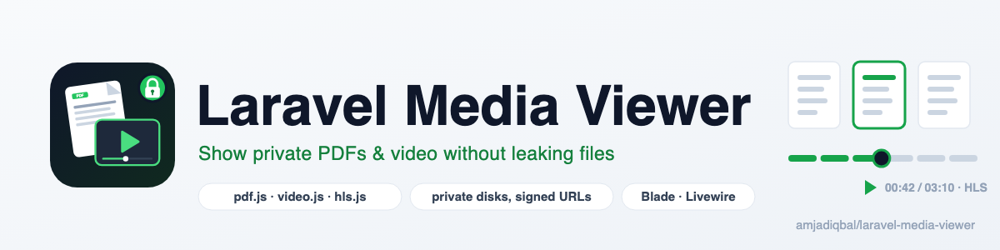
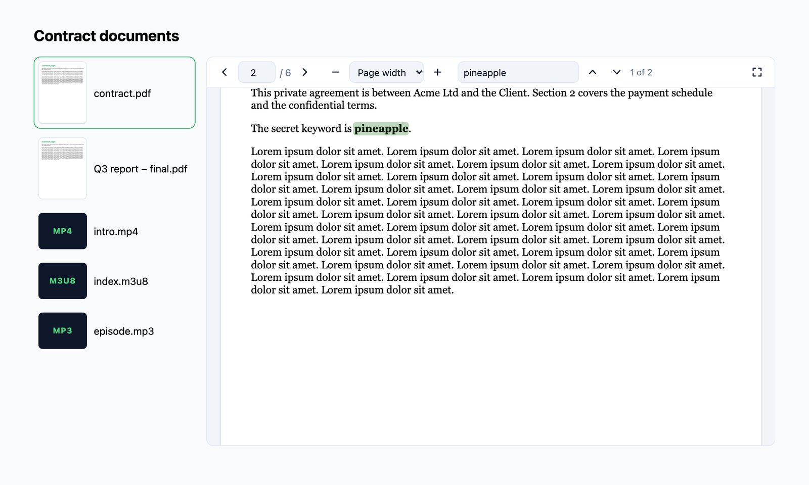

<p align="center">
  <picture>
    <source media="(prefers-color-scheme: dark)" srcset="art/banner-dark.png">
    
  </picture>
</p>

# Laravel Media Viewer: private PDF viewer and video player for Laravel

Show PDFs, video and audio stored on any Laravel disk, private ones included, without
making the files public. Blade and Livewire components give you a **pdf.js PDF viewer**
(page navigation, zoom, search, thumbnails) and a **Video.js player with HLS**, and every
file is served through a **signed, expiring, user-bound URL** with proper Range support.

[](https://packagist.org/packages/amjadiqbal/laravel-media-viewer)
[](https://packagist.org/packages/amjadiqbal/laravel-media-viewer)
[](LICENSE.md)

<p align="center"></p>

```blade
<x-media-viewer::pdf disk="s3" path="contracts/{{ $contract->file }}" />
<x-media-viewer::video disk="local" path="courses/intro/index.m3u8" />
```

## Why

Showing an uploaded file in Laravel usually means one of three compromises:

- **`storage:link` makes it public.** Anyone with the URL has the file, forever.
- **A plain download route breaks media.** Without Range requests, videos can't seek and
  large PDFs load in full before the first page appears.
- **The browser's own PDF viewer differs everywhere.** It looks different in each browser,
  ignores toolbar options in some, and behaves differently again on iOS.

This package fixes all three. Files stay on a private disk. The page gets a short-lived signed
URL that only the signed-in user can use. The stream route answers Range requests correctly,
and the viewers are the same pdf.js and Video.js UI in every browser.

## Features

- **PDF viewer** (pdf.js 6.4.299): page navigation, zoom steps, page width or whole page, text
  search with match count and highlighting, full screen, optional download button, keyboard
  friendly, dark mode.
- **PDF thumbnails** for lists, rendered lazily as they scroll into view. Through Range
  requests a thumbnail fetches only what its page needs. In our test, page 1 of a 4.6 MB,
  60-page PDF took 216 KB.
- **Video and audio** (Video.js 10.1.0): `.mp4`, `.webm`, `.mov`, `.mp3`, `.m4a`, `.ogg`, `.wav`,
  `.flac` and more, with seeking over Range requests.
- **HLS from a private disk**: `.m3u8` plays through Video.js's hls.js adapter. Playlists are
  rewritten so every variant, segment, init map and key is a signed URL too.
- **Livewire**: the components work inside Livewire components and with `wire:navigate`, and
  `<livewire:media-viewer-gallery>` gives you a file list with thumbnails next to a viewer.
- **Security** (details in [Security model](#security-model)): disk and extension allow-lists,
  signed and expiring URLs bound to the user, an optional Gate checked on every request,
  path-traversal protection, and Subresource Integrity for every pdf.js and Video.js file.
- Any disk: `local`, `public`, S3, R2 or anything else Flysystem supports. Optionally redirect
  to the disk's own temporary URL to save your server's bandwidth.

## Requirements

- PHP 8.3+
- Laravel 12 or 13
- Livewire 3 or 4, only for the gallery component (tested with Livewire 4.4)

## Installation

```bash
composer require amjadiqbal/laravel-media-viewer
```

That's all. There is nothing to build, and nothing to publish. The first viewer on a page
prints the small script and stylesheet it needs, and pdf.js and Video.js load from jsDelivr
with integrity hashes the first time they are used.

Then allow the disks you want to show (`local` and `public` are allowed by default):

```bash
php artisan vendor:publish --tag=media-viewer-config
```

```php
// config/media-viewer.php
'disks' => ['local', 'public', 's3'],
```

## Usage

### PDF

```blade
<x-media-viewer::pdf disk="local" path="contracts/acme.pdf" />

<x-media-viewer::pdf
    disk="s3"
    :path="$invoice->pdf_path"
    height="70vh"
    scale="page-fit"        {{-- auto, page-width (default), page-fit, or a number like 1.5 --}}
    :page="3"
    :download="true"
    :search="true"
    filename="Invoice 2026-001.pdf"
/>
```

### PDF thumbnails

```blade
@foreach ($documents as $document)
    <x-media-viewer::pdf-thumbnail
        disk="s3"
        :path="$document->path"
        :width="160"
        :page="1"
        :href="route('documents.show', $document)"
    />
@endforeach
```

### Video and HLS

```blade
<x-media-viewer::video disk="local" path="videos/intro.mp4" poster-path="videos/intro.jpg" />

{{-- .m3u8 switches to HLS automatically. Segments next to it on the same disk are signed for you. --}}
<x-media-viewer::video disk="s3" path="courses/101/index.m3u8" aspect-ratio="21 / 9" muted autoplay />
```

Options: `poster` (a URL) or `poster-path` (on the same disk), `aspect-ratio`, `autoplay`,
`muted`, `loop`, `preload`, and `hls` to force HLS for a source without the `.m3u8` extension.
Anything in the slot goes inside the `<video>` element, for example captions:

```blade
<x-media-viewer::video disk="local" path="videos/intro.mp4">
    <track kind="captions" srclang="en" label="English" src="{{ MediaViewer::url('local', 'videos/intro.en.vtt') }}" default>
</x-media-viewer::video>
```

### Audio

```blade
<x-media-viewer::audio disk="local" path="podcast/episode-12.mp3" />
```

### Pick the viewer from the file

```blade
<x-media-viewer::file :disk="$attachment->disk" :path="$attachment->path" />
```

### Public URLs

Every component also accepts `src` for a URL you already trust. It is not signed or checked:

```blade
<x-media-viewer::video src="https://stream.example.com/live/index.m3u8" />
```

### Livewire

The Blade components work inside Livewire components. Each viewer is keyed by its file, so
Livewire leaves it alone on unrelated updates and replaces it when the file changes. A
ready-made gallery is included:

```blade
<livewire:media-viewer-gallery disk="s3" :paths="$ticket->attachments->pluck('path')->all()" />
```

`disk` and `paths` are locked: the browser can choose among the files you passed, but it
can't add another file to the list.

If a viewer only appears after a Livewire action (in a modal, say), print the assets in your
layout's `<head>` and turn off automatic printing:

```blade
<head>
    ...
    @mediaViewerAssets
</head>
```

```dotenv
MEDIA_VIEWER_INJECT_ASSETS=false
```

### Signed URLs in your own code

```php
use AmjadIqbal\MediaViewer\Facades\MediaViewer;

MediaViewer::allows('s3', 'contracts/acme.pdf'); // disk, extension and Gate checks
MediaViewer::url('s3', 'contracts/acme.pdf');    // signed URL (default lifetime from config)
MediaViewer::url('s3', 'contracts/acme.pdf', 5); // ...valid for 5 minutes
```

## Security model

Each part below exists because something real goes wrong without it.

| Control | What it stops |
|---|---|
| **Disk allow-list** (`disks`) | A crafted request reading from a disk you never meant to expose. |
| **Extension allow-list with fixed Content-Types** (`extensions`) | The route serving an uploaded `.html` or `.svg` from your own origin (stored XSS). The disk's MIME guess is never used. |
| **Signed URLs** (Laravel URL signing) | Changing the disk or path in the URL. |
| **Expiry** (`ttl`, 120 minutes by default) | Links that keep working forever. Keep it longer than your longest video, because the player keeps making requests with the same URL while it seeks. |
| **User binding** (`bind_to_user`) | A copied link working for someone else. When a user is signed in, the URL only works for that user. |
| **Gate** (`gate`) | Access you revoke still working. The ability is checked when the viewer renders and again on **every** request, including each HLS segment. |
| **`Cache-Control: private, no-cache`** | A cached copy outliving a logout on a shared computer. The browser must revalidate, which re-runs the checks; an allowed viewer gets a cheap `304`. |
| **Path normalisation** | `../` escaping the disk root, in the URL or inside an HLS playlist. |
| **`Content-Security-Policy: sandbox`, `nosniff`** | A served file being treated as a page. |
| **Subresource Integrity** | A changed pdf.js or Video.js file on the CDN. Every module, including the dynamically imported Video.js chunks, is covered by an import map with sha384 hashes, and the pdf.js worker is fetched with its hash. |

A Gate example:

```php
// app/Providers/AppServiceProvider.php
Gate::define('viewMedia', function (?User $user, string $disk, string $path) {
    return $user && Document::where('path', $path)->where('team_id', $user->team_id)->exists();
});
```

```php
// config/media-viewer.php
'gate' => 'viewMedia',
```

**What this is not:** a viewer is not DRM. A browser that may view a file can always save it.
This package makes sure only the right people, and only for a while, get to view it.

## Delivery: stream or redirect

`delivery` is `stream` by default: the app streams every file itself, with full Range support,
from any disk.

For S3-compatible disks you can set `delivery` to `redirect`. The route still checks the signature,
user and Gate, then redirects to the disk's own `temporaryUrl()`, so the bytes come straight
from the bucket. HLS playlists are still rewritten by the app. pdf.js and hls.js fetch the file
with JavaScript, so the bucket needs CORS:

```json
[{ "AllowedOrigins": ["https://your-app.com"], "AllowedMethods": ["GET", "HEAD"], "AllowedHeaders": ["Range"], "ExposeHeaders": ["Content-Range", "Content-Length", "Accept-Ranges"] }]
```

## Assets: CDN or self-hosted

By default pdf.js 6.4.299 and Video.js 10.1.0 load from jsDelivr, pinned to exact versions,
with integrity hashes. To serve them from your own domain instead:

```bash
npm i -D pdfjs-dist@6.4.299 @videojs/cdn@10.1.0
php artisan media-viewer:assets
```

```dotenv
MEDIA_VIEWER_ASSETS=local
```

The command copies only the files the viewers load into `public/vendor/media-viewer`, and
refuses any file whose hash doesn't match the pinned version.

**Content Security Policy:** allow `script-src` and `style-src` for `https://cdn.jsdelivr.net`
(unless self-hosted), `connect-src` for the same (pdf.js fetches its worker, fonts and maps),
and `worker-src blob:` (the integrity-checked pdf.js worker starts from a blob URL).

## Configuration

All options, with comments, are in [`config/media-viewer.php`](config/media-viewer.php):
`disks`, `extensions`, `ttl`, `bind_to_user`, `gate`, `delivery`, `route.prefix`,
`route.middleware`, `assets.source`, `assets.integrity`, `assets.inject`, and the PDF defaults
(`height`, `scale`, `download`). The views and translations can be published too
(`--tag=media-viewer-views`, `--tag=media-viewer-lang`). Colours are CSS variables
(`--mv-accent`, `--mv-bg`, `--mv-surface`, ...) on `.mv`.

## Browser support

Tested in Chrome on macOS. In a real browser we checked PDF rendering, search, zoom and page
navigation; MP4 seeking over Range requests; a two-level HLS stream from a private disk;
audio; lazy thumbnails; the Livewire gallery; `wire:navigate`; user binding; and refused
tampered files. Video.js 10 and pdf.js 6 target current Chrome, Edge, Firefox and Safari
(including iOS). **Safari and iOS have not been tested by hand yet.** If you find a problem
there, please [open an issue](https://github.com/amjadiqbal/laravel-media-viewer/issues).

## Testing

```bash
composer test           # Pest
scripts/ci-local.sh     # Pint, PHPStan and Pest on PHP 8.3-8.5 x Laravel 12-13
```

## Need this built into your app, or something custom?

I build document portals, course platforms and Laravel packages for teams. If you'd rather
have private file viewing designed and wired into your app for you (per-team permissions,
watermarking, transcoding to HLS, audit logs), or need something this package doesn't do,
[get in touch](https://amjad.com.pk/contact?utm_source=github&utm_medium=readme&utm_campaign=laravel-media-viewer).

## Support

- 🐛 **Bug or feature request**: [open an issue](https://github.com/amjadiqbal/laravel-media-viewer/issues)
- 🔒 **Security issue**: please report privately via GitHub's security tab

## Need this customised, or something built?

I'm available for custom development, package integration, and technical consulting.

[](https://www.upwork.com/freelancers/amjadkhatri)

## More packages

Part of a family of open-source packages. See [all of them](https://github.com/amjadiqbal?tab=repositories).

| | |
|---|---|
| [laravel-driver-js](https://github.com/amjadiqbal/laravel-driver-js) | Product tours and onboarding for Laravel |
| [kiln](https://github.com/amjadiqbal/kiln) | Deploy-time OPcache control for Laravel |
| [laravel-tiptap](https://github.com/amjadiqbal/laravel-tiptap) | Tiptap editor for Laravel |
| [laravel-logpulse](https://github.com/amjadiqbal/laravel-logpulse) | Log health monitoring and alerting |

## Credits

- [pdf.js](https://github.com/mozilla/pdf.js) by Mozilla (Apache-2.0)
- [Video.js](https://github.com/videojs/video.js) (Apache-2.0), which bundles
  [hls.js](https://github.com/video-dev/hls.js) (Apache-2.0)
- This package is independent and not affiliated with Mozilla, Video.js or hls.js.
- [Amjad Iqbal](https://amjad.com.pk)

## License

MIT. See [LICENSE.md](LICENSE.md).
